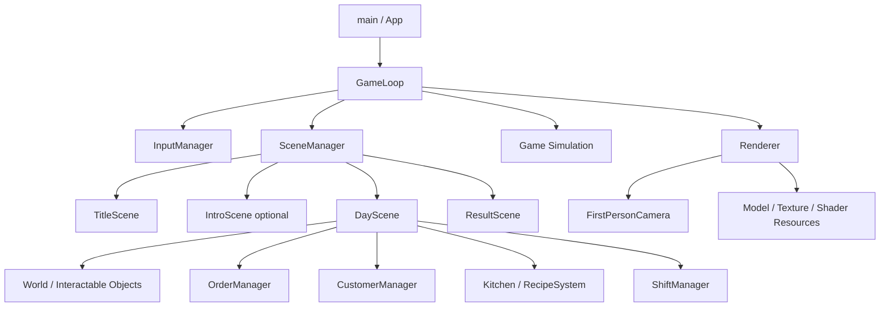

# 집게리아: 게살 버거 만들기 — 프레임워크 설계

## 1. 목표와 범위

기획서의 핵심 루프인 **출근 → 주문 받기 → 요리 → 서빙 → 마감/할당량 검사 → 다음 날**을 구현하기 위한 작은 게임 프레임워크다. 현재 프로젝트는 Visual Studio C++/OpenGL 실행 파일과 GLSL 셰이더를 중심으로 구성되어 있고 `main.cpp`가 비어 있으므로, 엔진 교체 없이 기존 GLFW/GLEW/OpenGL 기반에서 기능을 단계적으로 추가한다.

이번 프레임워크는 1인칭 이동, 조준점 기반 상호작용, 재료 들기와 조립, 패티 굽기, 최대 6개 테이블의 주문/서빙, 날짜별 목표 매출과 종료 화면을 지원한다. 손님 길찾기는 네비게이션 메시 대신 입구·카운터·테이블 사이의 미리 정한 경유점을 따라가는 방식으로 제한한다. 물리 엔진은 도입하지 않고 플레이어 AABB 충돌 및 간단한 낙하만 사용한다.

## 2. 설계 원칙

- **먼저 플레이 루프를 완성한다.** 타이틀부터 다음 날/게임 오버까지 한 번 이어지는 빌드를 만든 후 컷신과 특별 손님을 추가한다.
- **게임 규칙과 렌더링을 분리한다.** 주문 완료나 패티 굽기는 월드 모델의 이름이나 픽셀 색상에 의존하지 않는다.
- **현재 팀/기간에 맞게 단순하게 유지한다.** ECS, 범용 물리, 복잡한 행동 트리, 데이터베이스는 도입하지 않는다.
- **실행 가능한 중간 결과를 유지한다.** 각 주차마다 컴파일 가능한 상태로 통합한다.

## 3. 런타임 구성



프레임 순서는 `입력 수집 → 장면 입력 처리 → 고정 간격 게임 업데이트 → 렌더 → 창 이벤트 처리`로 둔다. `deltaTime`은 프레임 경과 시간이며, 업데이트에 상한(예: 0.05초)을 둬 창을 옮긴 뒤 큰 순간 이동이 생기지 않게 한다. 패티 익힘과 영업 시간은 프레임 수가 아니라 경과 초로 계산한다.

## 4. 권장 소스 구조

프로젝트 파일은 아래 `.cpp`를 포함하도록 갱신한다. 초기 통합 부담을 줄이려면 1주 차에는 `main.cpp` 한 파일의 영역/클래스로 시작해도 되며, 기능이 안정된 뒤 같은 경계로 파일을 분리한다.

```text
CGFP/CGFP/
  main.cpp                 # 진입점, App 초기화와 루프
  core/
    Game.h/.cpp            # 고정 업데이트, 장면 전환, 종료
    Input.h/.cpp           # 키/마우스 상태와 눌림 이벤트
    Scene.h                # Scene 인터페이스, SceneManager
    ResourceManager.h/.cpp # 셰이더/텍스처/모델 수명 관리
  graphics/
    Camera.h/.cpp          # FPS 카메라, view/projection
    Renderer.h/.cpp        # 모델과 월드 렌더링
    Shader.h/.cpp          # GLSL 로드/컴파일/유니폼
  game/
    DayScene.h/.cpp        # 플레이 장면 조립 및 UI
    Player.h/.cpp          # 이동/충돌/시선
    Interactable.h         # 상호작용 계약 및 종류
    World.h/.cpp           # 배치, 피킹, 충돌 질의
    Kitchen.h/.cpp         # 재료, 조리 단계, 레시피
    OrderManager.h/.cpp    # 주문 생성/검증/보상
    Customer.h/.cpp        # 손님 상태와 경유점 이동
    ShiftManager.h/.cpp    # 영업 타이머, 일일 목표/결과
    UI.h/.cpp              # 조준점, 프롬프트, 주문 목록, HUD
  assets/
    shaders/               # 기존 vertex.glsl / fragment.glsl 이동 또는 참조
    models/ textures/       # 압축 모델 에셋은 필요한 파일만 추출
```

헤더에는 타입/인터페이스를, `.cpp`에는 동작을 둔다. Visual Studio `.vcxproj`와 `.vcxproj.filters` 양쪽에 신규 파일을 등록하고, 셰이더/모델의 경로는 작업 디렉터리에 의존하지 않도록 `assets/` 기준 경로 헬퍼 하나로 통일한다. 기존 링크 설정은 `opengl32`, `glew32`, `glfw3`를 사용하므로 이 라이브러리 구성을 유지한다. GLM/모델 로더가 이미 프로젝트에 연결되어 있는지는 확인되지 않았으므로 새 의존성을 추가하기 전에 설치/링크 상태부터 확인한다.

## 5. 주요 모듈과 책임

| 모듈 | 책임 | 핵심 데이터/규칙 |
|---|---|---|
| `Game` / `SceneManager` | 앱 수명, 장면 전환, 업데이트 루프 | `Title → Intro(생략 가능) → Day → Result` |
| `InputManager` | GLFW 콜백을 한 곳에서 수집 | WASD 이동, 마우스 시선, E 들기/놓기, F 상호작용, Enter 컷신 건너뛰기, Esc 일시정지/종료 |
| `Player` / `Camera` | 플레이어 위치·방향·충돌, 시점 계산 | 카메라 pitch를 약 ±89°로 제한, yaw만 수평 회전, 이동은 카메라의 수평 전방/우측 벡터 사용 |
| `World` | 정적/동적 오브젝트 배치와 공간 질의 | 각 오브젝트의 위치, AABB, 상호작용 가능 여부 |
| `Interactable` | 조준 대상의 공통 동작 | `CanInteract`, `Interact`, `GetPrompt`; 대상별 처리 로직은 하위 타입에 둠 |
| `Kitchen` | 재료 운반/조립, 패티 조리 | 접시의 재료 스택, 패티 상태와 익힘 시간, 완성 음식 식별 |
| `OrderManager` | 주문 생성, 완료 음식 판정, 매출 반영 | 주문 ID, 메뉴/재료 조합, 제한 시간(선택), 보상 |
| `CustomerManager` | 손님 생성, 좌석 점유, 상태별 이동 | 손님 상태 `Entering → Ordering → GoingToSeat → WaitingForFood → Eating → Leaving` |
| `ShiftManager` | 영업일 진행 및 목표 매출 평가 | 현재 날짜, 남은 영업 시간, 당일 매출, 목표액, 결과 |
| `UI` | 최소 HUD와 안내 | 조준점, 상호작용 프롬프트, 주문표, 시간/매출/목표, 하루 결과 |
| `Renderer` / `ResourceManager` | OpenGL 리소스 및 시각화 | model/view/projection, 셰이더/텍스처/모델의 단일 소유자 |

**의존 방향:** 렌더러는 게임 규칙을 변경하지 않는다. UI는 `OrderManager`와 `ShiftManager`가 제공하는 읽기 전용 상태를 그린다. `Customer`는 주문/좌석 ID를 보유하되 주문 완료 판정을 직접 처리하지 않는다. 이 경계를 지키면 모델/애니메이션이 늦어져도 게임 규칙을 테스트할 수 있다.

## 6. 플레이 데이터와 상태

```cpp
enum class SceneId { Title, Intro, Day, Result };
enum class DayPhase { Opening, Open, Closing, DayResult };
enum class CustomerState {
    Entering, Ordering, GoingToSeat, WaitingForFood, Eating, Leaving
};
enum class Ingredient { BottomBun, PattyRaw, PattyCooked, Cheese, Lettuce, TopBun };
enum class PattyState { Raw, Cooking, Cooked, Burnt };

struct Order {
    int id;
    int customerId;
    std::vector<Ingredient> required;
    float reward;
    bool completed;
};

struct Seat {
    int id;                 // 0..5
    bool occupied;
    int customerId;         // 없으면 -1
    glm::vec3 position;
};
```

요리 결과는 문자열/모델명 대신 `FoodItem { recipeId, ingredients, quality }` 같은 값으로 표현한다. MVP는 메뉴 한 종류만 지원하고, 레시피 비교는 필수 재료와 익힘 상태를 기준으로 한다. 완벽한 순서/물리 스택 판정보다는 접시 위에 재료를 놓을 때 순서대로 목록에 쌓는 방식으로 시작한다. 패티가 `Raw → Cooking → Cooked → Burnt`로 진행하고, 굽기 시간 경계는 상수로 모아 쉽게 조정한다.

## 7. 입력·피킹·상호작용 계약

### 입력

- GLFW 콜백은 입력 상태만 갱신한다. 게임 규칙을 콜백 안에서 직접 수행하지 않는다.
- 이동은 초당 속도 × `deltaTime`으로 처리하고 대각선 이동은 정규화한다.
- 마우스 첫 프레임은 기준 좌표 설정에만 사용한다. pitch 제한으로 카메라 뒤집힘을 방지한다.
- E는 들고 있는 물체가 있으면 놓기를 우선하고, 없으면 조준 가능한 재료를 든다. F는 현재 조준 대상의 상호작용을 실행한다.
- 실제 사용자 표기는 E/F 대문자로 통일한다(기획서 표에 `f`로 쓰인 항목 포함).

### 조준 피킹

카메라 위치 `origin`과 정규화한 전방 `direction`으로 최대 거리(예: 3m)의 ray를 만든다. MVP에서는 상호작용 물체의 AABB에 ray를 교차시켜 가장 가까운 양의 교차 거리 대상을 고른다. 후보가 없거나 최대 거리 밖이면 프롬프트를 숨긴다. 월드 모델을 그리는 transform과 충돌/피킹 AABB는 같은 오브젝트 transform에서 파생시켜 시각과 판정이 어긋나지 않게 한다.

놓기 대상은 플레이어 앞의 거리에서 바닥 방향으로 내려가는 간단한 raycast 또는 사전 지정 작업대 스냅 위치를 사용한다. 충돌이 있는 위치에는 놓을 수 없게 한다. MVP에 중력 시뮬레이션은 넣지 않고 놓은 오브젝트를 지면/작업대 높이에 맞춘다.

### 상호작용 인터페이스

```cpp
class Interactable {
public:
    virtual ~Interactable() = default;
    virtual bool CanInteract(const PlayerContext&) const = 0;
    virtual void Interact(PlayerContext&) = 0;
    virtual std::string GetPrompt(const PlayerContext&) const = 0;
};
```

작업대는 재료/패티를 받아 `Kitchen`에 전달하고, 손님은 완성 음식/활성 주문을 `OrderManager`에 전달한다. 계산대, 문, 음식은 상호작용 여부/프롬프트를 각 타입에서 제공한다. 한 프레임의 입력 처리에서 가장 가까운 하나의 대상만 활성화한다.

## 8. 손님·주문·영업 흐름

1. 영업 시작 시 손님을 일정 간격으로 생성한다(동시 손님 수는 좌석 6개 이하).
2. 빈 경유점 경로를 따라 입구에서 계산대로 이동하고, 도착하면 주문을 만든다.
3. 빈 좌석 하나를 예약하고 `GoingToSeat` 상태로 이동한다. 좌석이 없으면 생성/입장 대기한다.
4. 좌석에 도착하면 `WaitingForFood`; 말풍선/주문표는 주문 ID와 연결한다.
5. 플레이어가 들고 있는 완성 음식을 손님에게 F로 제공하면 주문 재료와 비교한다. 성공 시 매출/보상을 반영하고 먹는 상태 후 퇴장한다. 불일치 시 음식을 소비하지 않거나 피드백만 준다(정책은 MVP에서 한 가지로 고정).
6. 영업 시간이 끝나면 새 손님 생성을 막고 현재 손님의 상태를 정리한 뒤 당일 매출과 목표액을 비교한다.
7. 목표 달성 시 다음 날짜로 이동하고 목표/손님 속도를 갱신한다. 미달이면 게임 오버 결과를 보여준다. 최종 날짜 목표 달성 시 엔딩으로 전환한다.

고객 이동은 충돌 꼬임을 줄이기 위해 목표 좌석을 먼저 예약하고, 경유점 순서로 보간 이동한다. MVP에서는 손님끼리 물리 충돌을 계산하지 않는다. 경로가 막힌 것처럼 보일 때는 이동을 멈추고 짧게 기다린 뒤 계속 이동한다.

## 9. 화면/장면 상태

- **Title:** 게임 시작, 설정(마우스 감도/음량은 시간 여유 시), 종료.
- **Intro (선택):** 카메라/캐릭터 변환과 짧은 대사. Enter로 즉시 `Day` 진입.
- **Day:** 3D 가게, 중앙 조준점, 상호작용 안내, 활성 주문표, 날짜/영업 시간/당일 매출/목표 HUD.
- **DayResult:** 할당량 달성 여부와 다음 날/게임 종료 진입.
- **Result:** 성공/게임 오버 결과와 타이틀 복귀.

장면마다 GLFW 창/GL 컨텍스트를 새로 만들지 않는다. `SceneManager`가 장면 객체를 교체하고 공통 `Renderer`, `ResourceManager`는 앱 수명 동안 유지한다.

## 10. 구현 순서와 완료 기준

| 우선순위 | 작업 묶음 | 완료 기준 |
|---|---|---|
| 0 | 앱 골격/렌더 루프/장면 전환 | 타이틀 화면에서 Day 장면으로 진입하고 종료 가능 |
| 1 | 이동/카메라/기본 맵 | WASD로 이동, 마우스 시선, pitch 제한, 바닥/벽 충돌 |
| 2 | 피킹/들기/놓기/상호작용 | 조준 중 프롬프트, E로 재료 픽업/배치, F로 작업대 상호작용 |
| 3 | 요리 MVP | 재료를 접시에 놓아 메뉴 1종 완성, 패티 익힘/탄 상태 확인 |
| 4 | 손님/주문/서빙 | 계산대 주문 → 빈 좌석 배정(최대 6) → 맞는 음식 전달 → 매출 증가 |
| 5 | 근무/결과 화면 | 타이머 종료, 할당량 달성/미달, 다음 날/게임 오버 전환 |
| 6 | 폴리싱 | 애니메이션/컷신/특별 손님/플랑크톤 이벤트 중 선택 |

기획서 일정의 순서를 유지하되, **통합 빌드에서 우선순위 0~5가 끝나기 전에는 6번을 착수하지 않는다.** 일정상 컷신은 선택 사항이고, 게임 루프에 필수인 하루 종료/목표 판정을 컷신보다 우선한다.

## 11. 두 명의 작업 경계와 통합

기획서 A(이충원)는 플레이어/카메라, 피킹/운반, 요리, 영업 마감 로직을 맡는다. B(이초원)는 장면/타이틀, 월드 배치, 손님/주문/서빙, HUD를 맡는다.

공유 계약은 초기에 같이 확정한다: `Interactable` 인터페이스, `Ingredient/FoodItem/Order` 타입, 손님 상태 전이, 플레이어가 들고 있는 아이템 접근 방법, 주문 완료/매출 변경 함수. 같은 파일을 동시에 편집하지 않고, 모듈은 헤더 경계를 통해 연결한다. 매주 통합 시에는 프로젝트 파일 등록, 에셋 경로, Debug x64 설정을 함께 확인하고 한 사람이 합친 실행본을 유지한다.

## 12. 리스크 및 완화

| 위험 | 완화 |
|---|---|
| 시선 조준 대상이 깜빡이거나 엉뚱함 | AABB raycast 최대 거리/가장 가까운 대상, 프롬프트 표시와 E/F 판정을 동일 타깃 변수로 공유 |
| 카메라 상하 회전 뒤집힘 | pitch clamp, 첫 마우스 이벤트 무시, 감도 설정 상수화 |
| 놓은 재료가 바닥에 끼거나 공중에 뜸 | 작업대별 스냅 위치, 바닥/작업대 높이 우선 사용 |
| 손님이 같은 자리에 겹침 | 좌석 예약을 이동 전에 수행, 손님 동시 수를 좌석 수로 제한 |
| 모델/텍스처 에셋 통합 지연 | 회색 박스/기본 도형으로 규칙과 카메라부터 완성, 필요한 모델만 단계적으로 연결 |
| 기능 병합 중 프로젝트가 빌드되지 않음 | 작은 커밋/통합 단위마다 Debug x64 빌드, `.vcxproj`와 `.filters` 동시 갱신 |

## 13. 프로젝트에 즉시 적용할 결정

1. 게임 규칙은 OpenGL 렌더 코드에서 분리하고 `DayScene::Update`에서 갱신한다.
2. 물체 조준은 AABB raycast, 플레이어 벽 충돌은 AABB, 손님 이동은 고정 경유점으로 시작한다.
3. E는 픽업/놓기, F는 작업대/손님/문 등 사용으로 고정한다.
4. 요리는 접시의 `vector<Ingredient>`와 패티 타이머로 표현한다.
5. 손님 자리는 정확히 6개, 좌석은 이동 전에 예약한다.
6. 날짜 시스템과 할당량 검사까지를 필수 완료 범위로 하고, 컷신/특별 이벤트는 마지막에 넣는다.

